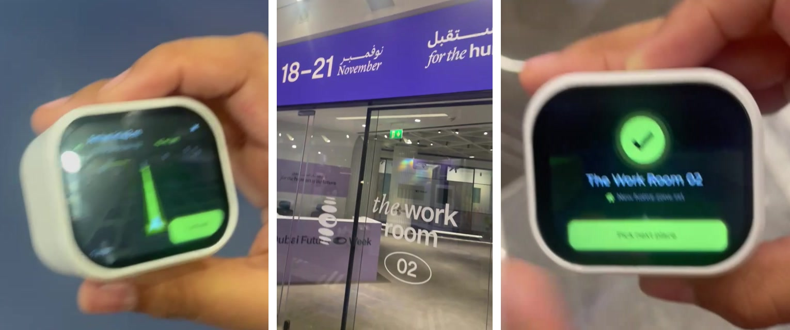

# Future Week Navigator

📄 **Read the paper on Zenodo:** https://zenodo.org/records/24437857

A small handheld device that guides visitors around big indoor events like **Dubai Future Week**, with no GPS, no phone and no app. Tap where you want to go, follow the 3D map and arrow, and it says **"You've arrived!"**

## Highlights

- **Two working versions**
  - **Platform A: CGOTCHI (ESP32-S3).** Fully offline. Counts your steps along the planned route.
  - **Platform B: Waveshare ESP32-S3-Touch-AMOLED-1.8.** Uses the venue Wi-Fi and the Google Geolocation API, with step counting between location fixes.
- **Home zones.** Every place you arrive at becomes your new starting point, so step-counting errors never build up.
- **Tested at Dubai Future Week** on 21 November 2026: S+T+A+R+S exhibit to The Work Room 02 in about 40 seconds.
- **Controlled tests:** step detection 100% (100 of 100), Wi-Fi location 86% (86 of 100). Battery runtime not measured.

## What's in this repository

| Path | Contents |
|---|---|
| [`paper/Future_Week_Navigator_Lakshveer_Rao.pdf`](paper/Future_Week_Navigator_Lakshveer_Rao.pdf) | Research paper (PDF) |
| [`paper/paper.md`](paper/paper.md) | Research paper (Markdown) |
| [`docs/technical-reference.md`](docs/technical-reference.md) | Full technical reference for builders: hardware, pin maps, firmware, positioning, Google Geolocation, docks |
| [`docs/build-summary.md`](docs/build-summary.md) | Plain-language summary of how the project was planned and built |
| [`media/`](media/) | Figures and the pilot test video from Dubai Future Week |

## Paper

Lakshveer Rao, *Future Week Navigator: Indoor Wayfinding on Low-Cost ESP32-S3 Handhelds Using Route-Constrained Dead Reckoning, Home-Zone Resets and Wi-Fi Geolocation*, November 2026. Zenodo. https://doi.org/10.5281/zenodo.24437857

- **Zenodo record:** https://zenodo.org/records/24437857
- **DOI:** [10.5281/zenodo.24437857](https://doi.org/10.5281/zenodo.24437857)
- **PDF in this repo:** [`paper/Future_Week_Navigator_Lakshveer_Rao.pdf`](paper/Future_Week_Navigator_Lakshveer_Rao.pdf)

## Acknowledgements

Planning, research and documentation were assisted by Claude (Anthropic), and the device firmware was developed with Claude Code.

## License

The paper, documentation, figures and video are released under [Creative Commons Attribution 4.0 (CC BY 4.0)](https://creativecommons.org/licenses/by/4.0/). You may share and adapt them as long as you credit the author.
