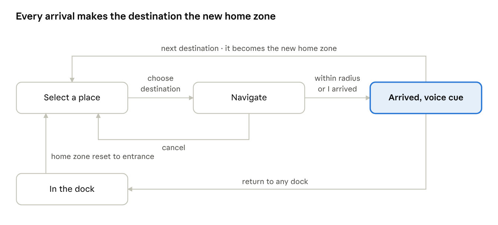
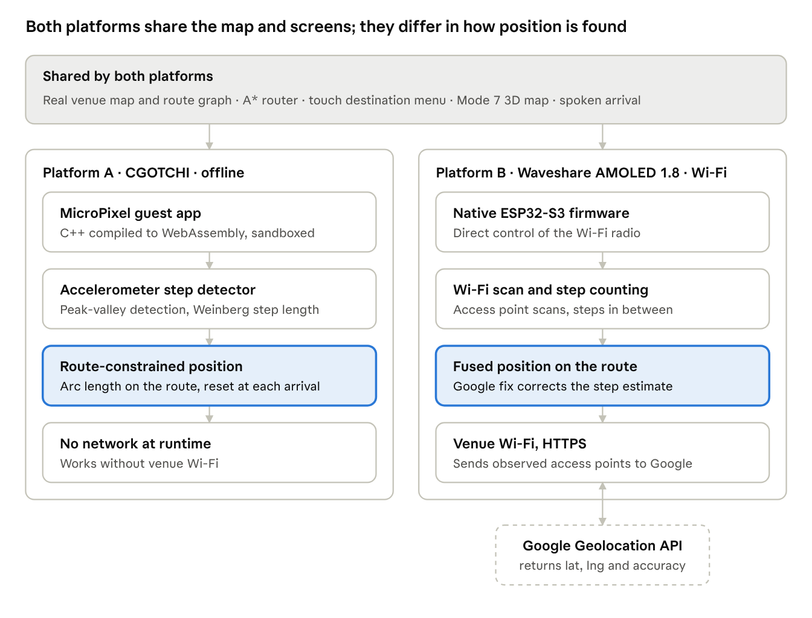
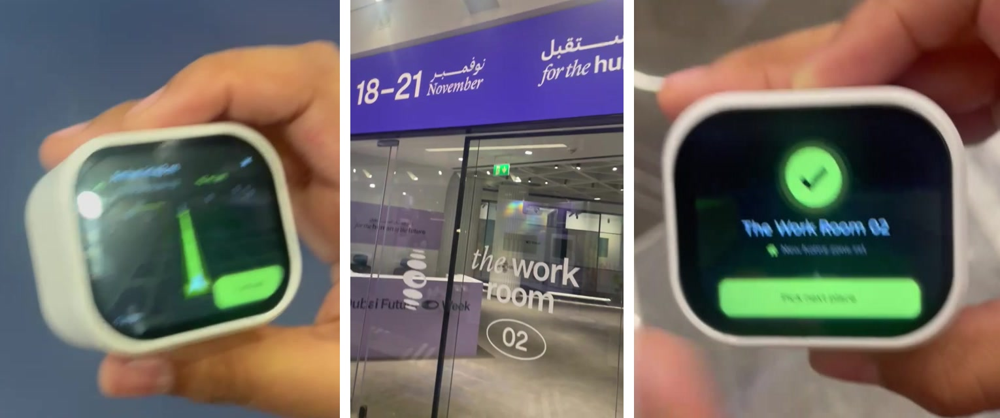
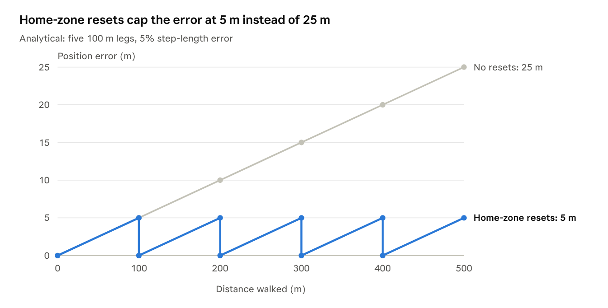

# Future Week Navigator: Indoor Wayfinding on Low-Cost ESP32-S3 Handhelds Using Route-Constrained Dead Reckoning, Home-Zone Resets and Wi-Fi Geolocation

**Lakshveer Rao**

*November 2026*

## Abstract

Large indoor events such as Dubai Future Week distribute printed and mobile maps, yet visitors still struggle to answer two basic questions: where am I, and which way do I turn? Satellite positioning is unavailable indoors, and most indoor positioning systems require dedicated infrastructure, site surveys or a smartphone app. We present Future Week Navigator, a shareable handheld wayfinding device implemented on two low-cost ESP32-S3 platforms. Both preload the venue map, let the visitor choose a destination from a touch menu, render a perspective 3D map with a route overlay and announce arrival by voice. Platform A, a CGOTCHI kit with a 2.01-inch touchscreen and only a 3-axis accelerometer, runs fully offline. Because it cannot sense heading, position is modelled as one-dimensional progress along the planned route, advanced by accelerometer step detection with a Weinberg step-length model, and every arrival establishes a new home zone that resets the estimate, so drift is confined to a single leg rather than accumulating over a visit. Platform B, a Waveshare ESP32-S3-Touch-AMOLED-1.8 with a 1.8-inch AMOLED display, joins the venue Wi-Fi, scans nearby access points and obtains absolute position fixes from the Google Geolocation API, using step counting to carry the position between fixes. Both systems have been built, flashed and run end to end with the real venue map, the concept has been presented to the event organisers, and a pilot run inside the venue during the event is documented on video. In controlled tests, step detection was 100% accurate (100 of 100 steps) and Wi-Fi location was correct in 86 of 100 trials. We describe the architecture, the two positioning methods and their error behaviour, the docking-station operating model, an evaluation protocol, and the trade-off between an infrastructure-free offline design and a network-assisted one.

**Keywords:** indoor navigation, wayfinding, pedestrian dead reckoning, ESP32-S3, embedded systems, Wi-Fi geolocation, assistive technology, event technology

## 1. Introduction

Wayfinding at large temporary events is a persistent usability problem. Venues are unfamiliar, crowded and frequently reconfigured, and visitors include children, older people and international guests who may not read the local language. Organisers typically respond with printed maps and a map inside the event app. Both present the entire venue at once and leave the visitor to localise themselves and plan turns while walking, a cognitively demanding task in a crowd.

Outdoors, this problem is solved by GNSS-based turn-by-turn navigation. Indoors, GNSS signals are attenuated or absent, and the literature offers a broad range of alternatives, from Wi-Fi fingerprinting \[1\]\[2\] and Bluetooth Low Energy beacons \[3\] to inertial pedestrian dead reckoning (PDR) \[4\]\[5\] and round-trip-time ranging \[6\]\[7\]. Most of these assume either a smartphone with a full inertial sensor suite or deployed radio infrastructure and an offline survey. Neither assumption fits a low-cost, shareable device that an event can hand out at the entrance.

This paper asks two questions. Can useful turn-by-turn indoor wayfinding be delivered on the cheapest class of hardware: a single accelerometer, no heading sensor, no network and no infrastructure? And what does a cloud Wi-Fi geolocation service add when the venue's Wi-Fi is available? Our contributions are:

1. A complete wayfinding system for commodity ESP32-S3 handhelds, combining a touch destination menu, a perspective 3D map with route overlay and spoken arrival, which runs fully offline on an accelerometer-only device (Platform A).
2. A route-constrained PDR formulation that tracks position as arc length along the planned route, which makes heading unnecessary and removes lateral drift while the visitor stays on the route.
3. A home-zone reset scheme in which every arrival re-anchors the estimate, bounding error to a single leg without any infrastructure.
4. An operating model built around docking stations for charging, map updates and state reset, addressing the short battery life of small devices.
5. A pilot field test inside the Dubai Future Week venue during the event, controlled accuracy tests, an evaluation protocol covering both platforms, and a roadmap for further radio-based positioning.
6. A second implementation on a Waveshare ESP32-S3-Touch-AMOLED-1.8 that combines Google Geolocation API fixes over the venue Wi-Fi with step counting, and a qualitative comparison of the offline and network-assisted designs.

## 2. Background and Related Work

### 2.1 Radio-based indoor positioning

RADAR introduced Wi-Fi received signal strength (RSS) fingerprinting, matching observed RSS vectors against a surveyed radio map, and Horus refined it probabilistically. Fingerprinting achieves metre-level accuracy but requires an offline survey that degrades when access points move or crowds change the propagation environment. BLE beacon fingerprinting adds deployed beacons, giving the operator control over anchor density and placement, but still requires a survey. IEEE 802.11mc fine timing measurement (FTM) estimates range from round-trip time; metre-level ranging is achievable in low-multipath, line-of-sight conditions or at 80 MHz bandwidth, but indoor errors of several metres are common at the 20–40 MHz bandwidths available at 2.4 GHz, and responder-capable infrastructure is required \[7\]. Web geolocation services such as the Google Geolocation API resolve a list of observed access points to a coordinate without a site survey, but depend on network access and crowd-sourced database coverage. Zafari et al. \[9\] and Gu et al. \[10\] give comprehensive surveys.

### 2.2 Inertial pedestrian dead reckoning

PDR estimates displacement by detecting steps, estimating step length and integrating along an estimated heading. Weinberg's model estimates step length from the fourth root of the vertical acceleration range. PDR needs no infrastructure but drifts: heading error causes lateral divergence and step-length error causes along-track divergence. Map matching and particle filters constrained by walls reduce drift substantially, but still require a heading estimate.

### 2.3 Our approach in context

Existing work largely assumes a smartphone-class sensor suite or infrastructure. Platform A has neither: an accelerometer without gyroscope or magnetometer. Rather than estimating heading poorly, we remove the need for it by constraining the estimate to the computed route and by resetting state at every arrival. Platform B keeps this formulation but adds survey-free absolute fixes from a cloud Wi-Fi geolocation service, placing it between purely inertial PDR and surveyed fingerprinting.

## 3. System Design

### 3.1 Requirements

The design was driven by five requirements. The device must work indoors without GPS. It must work without the visitor's phone, data or an app download. Interaction must be simple enough for children, older visitors and non-native speakers. The device must be shareable and quickly reset between visitors. Finally, it must be built from low-cost, readily available hardware.

### 3.2 Interaction model

A visitor collects a device from a dock at the entrance, which serves as the initial home zone. The SELECT screen shows large destination tiles with distances. Choosing one enters NAVIGATE, which shows a tilted 3D map with the route, the user's position and a card with the next instruction and remaining distance. On arrival, triggered automatically or by an "I arrived" control, the device enters ARRIVED, plays a spoken "You've arrived!" cue and sets the destination as the new home zone. The visitor then chooses the next destination or returns the device to any dock, which resets it to the entrance (Fig. 1).



*Figure 1. Visitor interaction state machine.*

### 3.3 Hardware platforms

The navigator has been implemented on two ESP32-S3 platforms (Fig. 2). Platform A is the CGOTCHI (Cheeko Gotchi) kit \[12\] and runs the offline variant (Table 1).

| Subsystem | Component |
| --- | --- |
| SoC | ESP32-S3R8, dual-core Xtensa LX7 up to 240 MHz, 2.4 GHz Wi-Fi, BLE 5 |
| Memory | 16 MB flash, 8 MB octal PSRAM |
| Display | JD9853 2.01" IPS, 296 x 240 (landscape), SPI |
| Touch | CST810 capacitive, I2C |
| Audio | ES8311 codec, NS4150B class-D amplifier, 3 W speaker |
| Motion | SC7A20 / LIS2DH12-class 3-axis accelerometer |
| Power | 600 mAh Li-ion, estimated 3 to 4 h runtime, USB-C |
| Size | 48 x 41 x 26 mm |

*Table 1. Platform A (CGOTCHI) hardware \[12\].*

Platform A's notable omission is any heading sensor, a constraint that shapes the positioning method in Section 5.

Platform B is the Waveshare ESP32-S3-Touch-AMOLED-1.8 \[14\] and runs the network-assisted variant (Table 2).

| Subsystem | Component |
| --- | --- |
| SoC | ESP32-S3R8, dual-core Xtensa LX7 up to 240 MHz, 2.4 GHz Wi-Fi 802.11 b/g/n, BLE 5 |
| Memory | 16 MB NOR flash, 8 MB PSRAM |
| Display | 1.8" AMOLED, 368 x 448, 16.7M colours, QSPI (SH8601 on V1 boards, CO5300 on V2) |
| Touch | Capacitive, I2C (FT3168 on V1, CST820 on V2) |
| Motion | QMI8658 6-axis IMU (3-axis accelerometer and 3-axis gyroscope) |
| Audio | ES8311 codec, onboard speaker and microphone |
| Power | AXP2101 PMU, external 3.7 V Li-ion cell on an MX1.25 connector (400 mAh recommended), USB-C |
| Other | PCF85063 RTC, TCA9554 I/O expander, TF card slot, PWR and BOOT buttons, USB-C |

*Table 2. Platform B (Waveshare ESP32-S3-Touch-AMOLED-1.8) hardware \[14\].*

Compared with Platform A's compact 48 x 41 x 26 mm body, Platform B has a slightly smaller but higher-resolution, higher-contrast AMOLED screen, adds a gyroscope and a microphone, and is programmed as native firmware with direct access to the Wi-Fi radio.

### 3.4 Software architecture

Platform A runs MicroPixel host firmware \[12\] on ESP-IDF, which owns all drivers and exposes a sandboxed API to guest applications compiled from C++ to WebAssembly and then ahead-of-time compiled for the Xtensa core. On Platform A the navigator is a guest application composed of a venue store, an A\* router, a step detector, a route-constrained position estimator, a Mode 7 renderer, an instruction generator and an audio cue module. Guest installation over USB leaves the host firmware untouched, which makes deployment safe and repeatable across a fleet.

Platform B runs custom native firmware on the ESP32-S3, implementing the same components natively. Because it is not sandboxed, the firmware controls the Wi-Fi radio directly: it joins the venue network, scans nearby access points, sends the observed access points to the Google Geolocation API over HTTPS and feeds the returned fix into the position estimator alongside the step detector. The user-facing flow, the venue model, routing and the arrival cue match Platform A.



*Figure 2. System architecture of Platform A (CGOTCHI, offline) and Platform B (Waveshare AMOLED 1.8, Wi-Fi geolocation).*

Figure 2 shows the shared pipeline and the point where the two platforms diverge: how the position on the route is obtained.

## 4. Venue Model and Routing

The venue is represented in a local Cartesian frame in metres with the entrance as origin. Walkable space is modelled as a graph whose nodes lie on corridor centrelines and at decision points, with edges weighted by length times a congestion multiplier of at least 1, which keeps the Euclidean A\* heuristic admissible. Points of interest attach to graph nodes and carry an arrival radius. Hall footprints are stored as polygons and rasterised into a floor texture. A georeference block (translation, rotation, uniform scale to WGS84) maps Platform B's WGS84 fixes into the venue frame (Section 5.5).

The official floor plan is converted by scaling from surveyed reference distances, tracing the corridor graph, georeferencing with control points, rasterising the texture and validating that every point of interest is reachable from the entrance. Routes are computed with A\* using the Euclidean heuristic and converted to a polyline P with cumulative arc length S and total length L. At each interior vertex the signed turn angle determines the instruction: below 30 degrees the vertex is suppressed, between 30 and 135 degrees it yields a left or right turn, and above 135 degrees a turn-around.

## 5. Positioning Method

### 5.1 Step detection and step length

The accelerometer is sampled at 50 Hz. The acceleration magnitude is low-pass filtered with a first-order IIR filter (cut-off about 3 Hz), and a peak-valley detector emits a step when a peak above 1.15 g follows a valley below 0.90 g with at least 300 ms since the previous step. Step length is estimated with the Weinberg model \[11\], applied to the filtered acceleration magnitude as a proxy for vertical acceleration because the handheld's orientation is unknown:

`l_k = K * (a_max,k - a_min,k)^(1/4)`

where a\_max,k and a\_min,k are the filtered peak and valley of step k and K is calibrated per device by walking a measured line. A constant 0.7 m serves as a fallback when uncalibrated.

### 5.2 Route-constrained state

Platform A has no heading sensor, so a free 2D PDR estimate would diverge immediately, and Platform B's gyroscope gives only relative heading, which also drifts without an absolute reference. Both platforms therefore assume the user follows the displayed route and represent position by the scalar arc length s along P:

`s_k = min(L, s_(k-1) + l_k)`

The displayed position is P(s), and the camera yaw follows the bearing of the current segment. This formulation has two consequences. The displayed position cannot leave the route, so there is no lateral drift; the price is that a visitor who leaves the route is not observed (Section 8). The remaining error is along-track and comes from missed or spurious steps, step-length error, and the difference between the distance actually walked (weaving through crowds, detouring around obstacles) and the centreline arc length, which biases s ahead of the true position.

### 5.3 Home-zone resets

Let the relative along-track scale error be e. On a leg of length L, the position error at nominal arrival is approximately e \* L. Without resets, a systematic scale error accumulates over a visit of n legs to e \* (L\_1 + ... + L\_n), proportional to total distance walked; zero-mean random per-step errors add a smaller term that grows only with the square root of the number of steps. With home-zone resets, the estimate is re-anchored to the true destination at every arrival, so the error at distance s into leg i is e \* s <= e \* L\_i, independent of earlier legs. This assumes the visitor physically reaches each destination before choosing the next; otherwise the residual offset carries into the next leg. For an assumed e = 0.05 (to be replaced by the along-track error measured in the full trials) and a 120 m leg, the bound is 6 m, within the arrival radius of large destinations such as stages and halls. The "I arrived" control acts as a zero-cost human-in-the-loop correction that both terminates the leg and re-anchors the estimate.

### 5.4 Arrival detection

Arrival is triggered when s >= L - r, where r is the destination's arrival radius, or immediately when the user presses "I arrived". The device then plays the arrival clip and promotes the destination to home zone.

### 5.5 Wi-Fi geolocation with step counting (Platform B)

Platform B adds absolute fixes from the Google Geolocation API \[8\]. The firmware performs an active scan of the 2.4 GHz band and submits the BSSIDs and received signal strengths of the visible access points:

```
POST https://www.googleapis.com/geolocation/v1/geolocate?key=API_KEY
{ "considerIp": false,
  "wifiAccessPoints": [ { "macAddress": "..", "signalStrength": -52, "channel": 6 }, ... ] }
-> { "location": { "lat": .., "lng": .. }, "accuracy": .. }
```

The API requires at least two access points and locates only universally administered MAC addresses, so randomised and phone-hotspot BSSIDs, which are common at events and not stationary, contribute nothing or degrade the fix; IP-based fallback is disabled (considerIp: false) so that a failed Wi-Fi match is reported as no fix rather than a city-level position. The returned WGS84 coordinate is mapped into the venue frame through the georeference of Section 4, using an equirectangular approximation that is accurate over a venue a few hundred metres across:

`dx = (lng - lng0) * cos(lat0) * 111320,  dy = (lat - lat0) * 110770`

(metres per degree at the venue latitude of about 25° N, lat0 in radians), followed by the inverse of the venue rotation and scale. Fixes arrive only every few seconds and carry an uncertainty of metres to tens of metres, while steps arrive about twice per second with small per-step error. The two are therefore complementary: step counting carries the position smoothly between fixes, and each fix corrects the drift that step counting accumulates. Following the route-constrained state of Section 5.2, each fix is projected onto the route polyline to obtain an arc-length measurement s\_fix, and the device corrects the step-based estimate toward it with a gain set by the fix's reported accuracy, so precise fixes pull strongly and coarse fixes only nudge the estimate. Because Google's database is crowd-sourced, fix quality depends on how well it covers the venue's access points, and temporary event access points may be unknown to it; when no fix is available, Platform B behaves like Platform A.

## 6. Implementation

### 6.1 Rendering

The 3D view uses a Mode 7–style perspective ground plane (a per-scanline affine texture projection): the pre-rendered floor texture is projected row by row onto a tilted plane, with a camera placed behind and above the user's position looking along the route. The route polyline is projected per vertex and drawn as a glowing stroke, hall labels are drawn on top, and the user's position is fixed at the bottom centre of the screen. A critically damped spring smooths camera yaw at turns. The interface uses a dark palette (#0B0E13 background, #5EF2D6 accent) with touch targets of at least 6 mm (44 px on Platform A, about 76 px on Platform B), chosen for contrast on 1.8- to 2-inch displays in bright halls and, on Platform B's AMOLED, for lower power draw because dark pixels are unlit.

### 6.2 Audio

The arrival cue is a text-to-speech clip encoded as mono Ogg Opus at 24 kbps and played through the codec and amplifier, with a synthesised tone sequence as a fallback.

### 6.3 Docking and fleet operation

Docks at the entrance, exit and intermediate points supply USB-C power and connect through a hub to a fleet host running the MicroPixel command-line tools for Platform A and the corresponding USB flashing tools for Platform B's native firmware. On insertion, the host verifies the application and venue bundle versions, pushes updates, resets the home zone to the entrance and indicates readiness with a status light. Docks therefore solve four problems at once: charging, returns, state reset and synchronised map updates when the programme changes. Check-out and check-in records support loss tracking under the return policy chosen by the organisers.

### 6.4 Deployment status

Both platforms are implemented, flashed and operating end to end with the real Dubai Future Week venue map. Platform A provides destination selection, 3D route guidance, route-constrained step tracking, home-zone resets and spoken arrival, fully offline. Platform B provides the same experience on a 1.8-inch AMOLED display and adds Google Wi-Fi geolocation over the venue network, combined with step counting. The concept has been presented to the Dubai Future Week organisers.

### 6.5 Pilot field test at Dubai Future Week

A pilot run was recorded on video inside the Dubai Future Week venue on 21 November 2026, the final day of the event, using the network-assisted unit (Platform B). The run started at the S+T+A+R+S exhibit in the Dubai Future Solutions area, which the device showed as the current location ("You are here"). The destination "The Work Room 02", an offstage meeting room in the same building, was selected from the touch grid, and the device switched immediately to the 3D route view and guided the walk through the exhibition hall.

The 77-second video gives the following timeline:

1. 0:00–0:11. The device is introduced at the Dubai Future Solutions area.
2. About 0:16. The destination grid shows "S+T+A+R+S · You are here", with tiles including The Work Room 02 and Prompt House.
3. About 0:17.5. The Work Room 02 is tapped, and the 3D route view with the route line appears within about a second.
4. 0:19–0:53. The walk through the exhibition hall, with the route view visible on screen at several points.
5. About 0:54–0:56. Arrival at the glass entrance of The Work Room 02.
6. About 0:58. The arrival screen appears: "The Work Room 02 · New home zone set · Pick next place".
7. About 1:00. The destination grid returns with The Work Room 02 as the current location.

The run confirmed the home-zone reset of Section 5.3 in the real venue (Fig. 3): after arrival, the destination grid listed The Work Room 02 as the new current location. The time from selecting the destination to the arrival screen was about 40 s.



*Figure 3. Pilot run at Dubai Future Week, 21 November 2026 (frames from the test video). Left: the 3D route view while walking. Centre: the destination, The Work Room 02. Right: the arrival screen, "The Work Room 02 · New home zone set".*

This single run demonstrates end-to-end operation under live event conditions, with crowds and the venue's own Wi-Fi environment. It is not a statistical evaluation: the route length, the arrival error and whether arrival was detected automatically or confirmed with the "I arrived" control were not recorded, so the trials of Section 7 remain necessary.

## 7. Evaluation

### 7.1 Protocol

We define the following evaluation protocol for on-site trials (Table 3). Each metric is measured separately on Platform A and Platform B, with informed consent from participants and parental consent for minors.

| Metric | Method |
| --- | --- |
| Step detection error | Participants walk a counted 200-step course; compare detected and true steps |
| Step-length calibration error | Walk a 50 m measured line; compare estimated and true distance |
| Arrival error | For each leg, measure the distance between the user's true position and the destination when the device declares arrival |
| Route success rate | Fraction of trials in which first-time visitors reach the destination without assistance |
| Time to destination | Compared against a control group using the printed map |
| Usability | System Usability Scale (SUS) questionnaire \[15\] after the trial |
| Battery life | Continuous navigation loop at full brightness until shutdown |
| Geolocation fix error (Platform B) | Compare fixes against surveyed checkpoints across the venue; report the median and 95th-percentile horizontal error (CEP50, CEP95) |
| Fix availability and latency (Platform B) | Fraction of scans that return a fix, and time from scan start to fix, at quiet and peak hours |
| Platform comparison | Run the same legs on Platform A and Platform B and compare arrival error and success rate |

*Table 3. Evaluation protocol for on-site trials.*

### 7.2 Results

Table 4 reports the results measured so far: the pilot field test of Section 6.5, and two controlled tests carried out by the author. In the controlled tests, step detection was correct for 100 of 100 steps (100%), and Platform B's Wi-Fi location was correct for 86 of 100 trials (86%). Battery runtime was not measured. The remaining metrics of Table 3 (along-track distance error, arrival error in metres, SUS score, geolocation fix availability and latency, and the comparison with the printed map) require instrumented multi-participant trials and are left to future work.

In the pilot, the device guided the user to the correct destination under live event conditions, declared arrival at the room entrance, and re-anchored its position there as designed. A single run demonstrates feasibility rather than a statistical result; the analytical bound of Section 7.3 indicates the accuracy the full trials are expected to confirm.

| Measure | Result |
| --- | --- |
| Venue and date | Dubai Future Week, 21 November 2026 (final day, live event conditions) |
| Platform | B (Waveshare ESP32-S3-Touch-AMOLED-1.8, Wi-Fi geolocation + step counting) |
| Route | S+T+A+R+S exhibit (Dubai Future Solutions area) to The Work Room 02 |
| Routes attempted / completed | 1 / 1 |
| Destination reached | Yes, arrival screen shown at the room entrance |
| Time from selection to arrival screen | About 40 s (video timeline 0:17.5 to 0:58) |
| Route view shown after selection | Within about 1 s |
| Home-zone reset | Confirmed: next destination grid listed The Work Room 02 as the current location |
| Step detection accuracy (controlled test) | 100% (100 of 100) |
| Wi-Fi location accuracy, Platform B (controlled test) | 86% (86 of 100) |
| Battery runtime | Not measured |

*Table 4. Measured results: pilot field test (from the test video) and controlled tests.*

### 7.3 Analytical comparison

Independently of the trial data, the home-zone scheme changes the error growth from proportional to total distance walked to proportional to the current leg length. For a visit of five 100 m legs with e = 0.05, the error without resets grows linearly to 25 m (0.05 x 500 m) by the end of the visit, while with resets it never exceeds 5 m (0.05 x 100 m); the mean error over the visit falls from 12.5 m to 2.5 m (Fig. 4).



*Figure 4. Position error versus distance walked, with and without home-zone resets (analytical, e = 0.05, five 100 m legs).*

## 8. Discussion

The central design choice is to accept a strong assumption, that the user follows the displayed route, in exchange for removing heading from the problem. For the target use case this assumption is reasonable: the device's sole purpose is to guide the user along that route, and the 3D view makes the intended path explicit. When the assumption is violated, for example when a visitor takes a wrong turn, the estimate continues along the route and must be corrected by the user through the "I arrived" control or by cancelling and re-selecting from a known location. Detecting off-route walking requires an absolute fix or heading; Platform B's fixes provide the former (Section 5.5), and Section 9 extends this to Platform A.

A second insight is that operational design can substitute for sensing. Docks reset state, refresh maps and solve short battery life, and the arrival interaction doubles as a localisation correction. These choices are intended to let a low-cost device deliver dependable guidance without infrastructure, which the trials of Section 7 will test.

The two platforms represent two ends of a design trade-off. Platform A needs nothing from the venue: no network, no survey, no API key, and no cost per use, and its error is bounded by leg length through home-zone resets. Platform B needs the venue Wi-Fi, an API key and per-request billing, and its accuracy depends on Google's coverage of the venue's access points, but in return it obtains absolute fixes that correct a mis-estimated step length without any action from the user and could, with perpendicular-distance gating, flag a probable wrong turn. For organisers, the choice depends on whether reliable visitor-accessible Wi-Fi exists at the venue; Platform B is already such a hybrid: when no fix is available it falls back to Platform A's route-constrained behaviour, so where Wi-Fi is available it captures most of the benefit of both.

### 8.1 Limitations

Platform A cannot sense heading or detect off-route movement, and its guest sandbox exposes no radio API, so Wi-Fi and BLE positioning on Platform A require host firmware changes. Its estimated battery runtime of 3 to 4 h is shorter than an event day, and battery runtime was not measured on either platform. On both platforms, accuracy is expected to suffice for halls and stages but not for individual stalls. The MicroPixel runtime does not yet expose battery level or microphone input to guest applications.

Platform B adds its own limitations. It depends on the venue Wi-Fi being reachable without a captive portal, it requires a Google Cloud API key and billing, and an API key held in device firmware can be extracted, so production devices should call the API through a proxy that holds a restricted key. Its fix quality is limited by Google's coverage of temporary event access points and by the attenuation of 2.4 GHz signals in dense crowds, and Wi-Fi scanning shortens its battery life compared with an offline device.

## 9. Future Work

We plan four extensions. First, a host firmware extension exposing Wi-Fi scan results to the guest, enabling on-device RSS fingerprinting \[1\]\[2\] fused with route-constrained PDR through the accuracy-weighted correction of Section 5.5, with off-route detection by gating fixes on their perpendicular distance from the route. The same extension would let Platform A run the Google Geolocation fusion already used on Platform B. Second, moving the API key behind a proxy service with per-device rate limits. Third, Wi-Fi FTM ranging \[6\]\[7\] to ESP32-S3 (or ESP32-S2/C-series) anchors deployed as responders, which ESP-IDF supports on these chips but not on the original ESP32 \[13\], to provide range-based fixes at key decision points; because the ESP32-S3 is limited to 2.4 GHz and 40 MHz, per-anchor offset calibration and line-of-sight placement will be needed \[7\]. Fourth, relative heading from Platform B's QMI8658 gyroscope, and a magnetometer or 9-axis IMU to enable 2D PDR with a wall-constrained particle filter \[5\], plus per-destination voice announcements and multilingual audio.

## 10. Conclusion

Future Week Navigator demonstrates that a complete indoor wayfinding system can run end to end on a low-cost ESP32-S3 handheld with only an accelerometer, without GPS, network or infrastructure; the on-site trials of Section 7 will quantify its accuracy and usability. Constraining position to the planned route removes the need for heading, and home-zone resets bound dead-reckoning error to a single leg. Combined with a touch-first 3D interface, spoken arrival and a dock-based operating model, the result is a shareable device suited to large temporary events. A second implementation on a Waveshare AMOLED handheld shows that, where venue Wi-Fi is available, Google Wi-Fi geolocation combined with step counting adds absolute position fixes without any venue survey. A pilot run inside the Dubai Future Week venue during the event, together with controlled tests showing 100% step detection and 86% Wi-Fi location accuracy, supports the design; the remaining measurements of Section 7 are left to future work.

## Acknowledgements

The author thanks his family for their support. Planning, research and documentation were assisted by Claude (Anthropic), and the device firmware for both platforms was developed, built and flashed with Claude Code. The hardware platforms are the CGOTCHI kit running MicroPixel firmware and the Waveshare ESP32-S3-Touch-AMOLED-1.8.

## References

[1\] P. Bahl and V. N. Padmanabhan, "RADAR: An in-building RF-based user location and tracking system," in *Proc. IEEE INFOCOM*, vol. 2, Tel Aviv, Israel, Mar. 2000, pp. 775–784.

[2\] M. Youssef and A. Agrawala, "The Horus WLAN location determination system," in *Proc. ACM MobiSys*, Seattle, WA, USA, 2005, pp. 205–218.

[3\] R. Faragher and R. Harle, "Location fingerprinting with Bluetooth Low Energy beacons," *IEEE Journal on Selected Areas in Communications*, vol. 33, no. 11, pp. 2418–2428, Nov. 2015.

[4\] R. Harle, "A survey of indoor inertial positioning systems for pedestrians," *IEEE Communications Surveys & Tutorials*, vol. 15, no. 3, pp. 1281–1293, 2013.

[5\] O. Woodman and R. Harle, "Pedestrian localisation for indoor environments," in *Proc. ACM UbiComp*, Seoul, Korea, 2008, pp. 114–123.

[6\] *IEEE Std 802.11-2016, IEEE Standard for Information Technology—Telecommunications and Information Exchange Between Systems—Local and Metropolitan Area Networks—Specific Requirements—Part 11: Wireless LAN Medium Access Control (MAC) and Physical Layer (PHY) Specifications*, Dec. 2016. (Fine timing measurement, developed by Task Group 802.11mc, was first published in this revision.)

[7\] M. Ibrahim, H. Liu, M. Jawahar, V. Nguyen, M. Gruteser, R. E. Howard, B. Yu and F. Bai, "Verification: Accuracy evaluation of WiFi fine time measurements on an open platform," in *Proc. ACM MobiCom*, New Delhi, India, 2018, pp. 417–427.

[8\] Google, "Geolocation request and response," Geolocation API, Google Maps Platform documentation (accessed Nov. 2026). https://developers.google.com/maps/documentation/geolocation/requests-geolocation

[9\] F. Zafari, A. Gkelias and K. K. Leung, "A survey of indoor localization systems and technologies," *IEEE Communications Surveys & Tutorials*, vol. 21, no. 3, pp. 2568–2599, 2019.

[10\] Y. Gu, A. Lo and I. G. Niemegeers, "A survey of indoor positioning systems for wireless personal networks," *IEEE Communications Surveys & Tutorials*, vol. 11, no. 1, pp. 13–32, 2009.

[11\] H. Weinberg, "Using the ADXL202 in pedometer and personal navigation applications," Analog Devices Application Note AN-602, 2002.

[12\] ALTIO AI Pvt. Ltd., "micropixel-gotchi: MicroPixel WebAssembly runtime for the Cheeko Gotchi (CGOTCHI) board," GitHub repository (accessed Nov. 2026). https://github.com/ALTIO-AI-PRIVATE-LIMITED/micropixel-gotchi

[13\] Espressif Systems, "Wi-Fi FTM example," ESP-IDF (accessed Nov. 2026). https://github.com/espressif/esp-idf/tree/master/examples/wifi/ftm

[14\] Waveshare, "ESP32-S3-Touch-AMOLED-1.8," product wiki and documentation (accessed Nov. 2026). https://www.waveshare.com/wiki/ESP32-S3-Touch-AMOLED-1.8

[15\] J. Brooke, "SUS: A 'quick and dirty' usability scale," in *Usability Evaluation in Industry*, P. W. Jordan, B. Thomas, B. A. Weerdmeester and I. L. McClelland, Eds. London, U.K.: Taylor & Francis, 1996, pp. 189–194.
